<div align="center">

# 🐾 Buddy

### AI-Driven Pet Disease · Diagnosis · Treatment Manager

A web and mobile platform that gives cat and dog owners an AI-assisted first look at their pet's health,
then connects them with veterinary clinics for appointments, records, and adoption.


**Çankaya University · Software Engineering Department · SENG 491–492 Graduation Project**

</div>

---

## Contents

1. [What Buddy is](#what-buddy-is)
2. [Who uses it](#who-uses-it)
3. [How it works, end to end](#how-it-works-end-to-end)
4. [Architecture](#architecture)
5. [Features](#features)
6. [Data model](#data-model)
7. [Interface design](#interface-design)
8. [Repository layout](#repository-layout)
9. [Getting started](#getting-started)
10. [Testing](#testing)
11. [Project documents](#project-documents)
12. [Implementation status](#implementation-status)
13. [Team](#team)

---

## What Buddy is

Pet owners often cannot tell whether a symptom is serious, and finding and booking a suitable clinic takes several separate tools. Buddy puts those steps in one place, **for cats and dogs only**:

- **AI pre-diagnosis.** The owner describes symptoms, how long they have lasted, and optionally uploads photos. The AI returns a structured analysis: symptom analysis, possible causes, recommendations, and what to tell the veterinarian.
- **Clinic access.** Clinics are shown on a map; the owner requests an appointment and the clinic accepts or rejects it.
- **Shared health records.** The AI result and the veterinarian's own diagnosis are stored together on the pet's record.
- **Adoption.** Owners and clinics can list pets for adoption and browse a shared adoption pool.

Buddy is an **advisory and scheduling tool**. It does not provide treatment or emergency services, and an AI result is never a substitute for a veterinarian.

## Who uses it

| Role | Platform | What they do |
|------|----------|--------------|
| **Pet owner** | Mobile app, web client | Manage pets, run AI analyses, book appointments, find clinics, adopt or list pets |
| **Veterinarian** | Web | Handle appointment requests, view and update pet records, review AI diagnoses, add their own diagnosis, manage the clinic's adoption list |
| **Admin** | Web | Manage users and roles, clinics and other facilities, application and AI API configuration |

<div align="center">
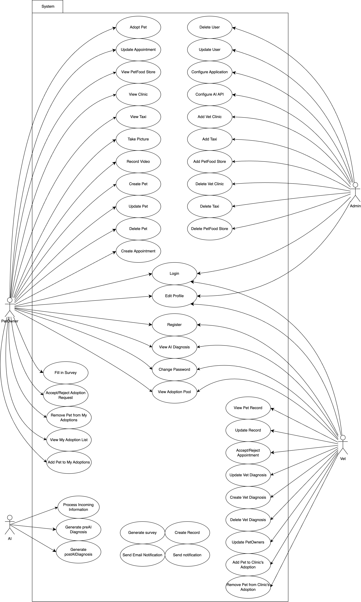
<br><sub>Use case diagram (SRS §3.2.2)</sub>
</div>

## How it works, end to end

The diagnosis runs in two stages: the owner's AI pre-diagnosis, then the veterinarian's refinement during the visit.

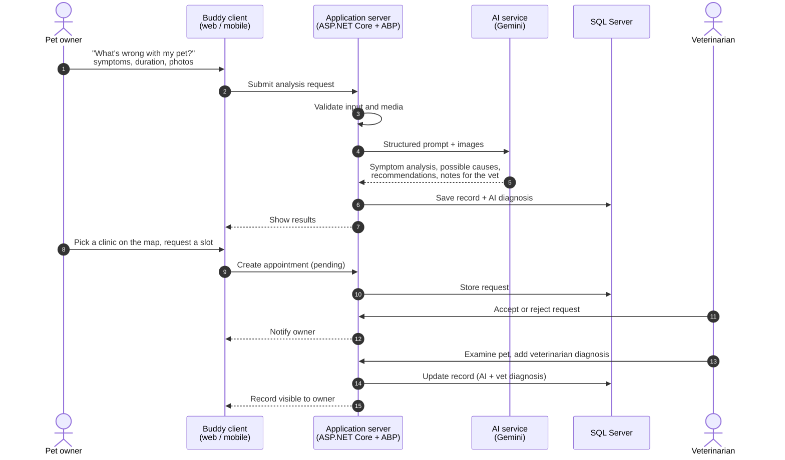

Appointment lifecycle:

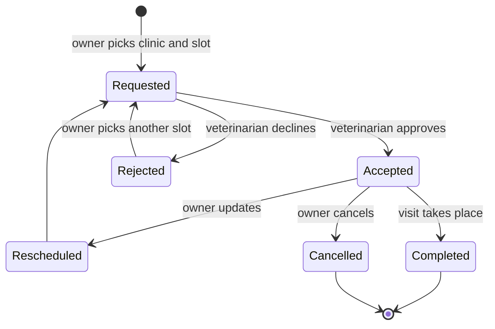

## Architecture

<div align="center">
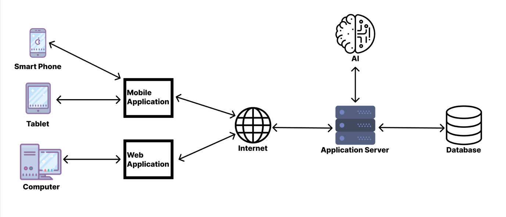
<br><sub>System architecture (SDD §2)</sub>
</div>

Clients talk to one application server, which owns the business logic, calls the AI service, and is the only component that touches the database.

The back end follows the layered ASP.NET Boilerplate (ABP) structure:

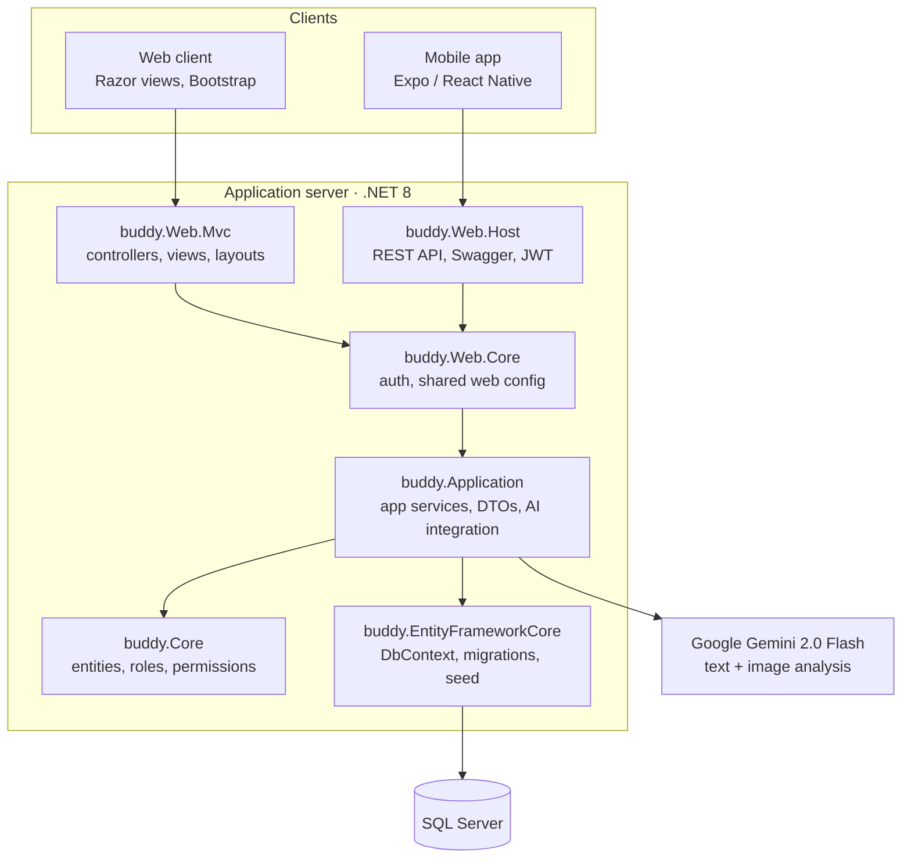

| Layer | Project | Responsibility |
|-------|---------|----------------|
| Presentation | `buddy.Web.Mvc` | Role-specific MVC controllers and Razor views for pet owners, veterinarians, and admins |
| API | `buddy.Web.Host` | REST endpoints with Swagger and JWT bearer authentication, used by the mobile app |
| Application | `buddy.Application` | Application services and DTOs: pets, appointments, records, clinics, adoptions, profiles, AI analysis |
| Domain | `buddy.Core` | Entities, authorization (roles and permissions), localization, multi-tenancy |
| Infrastructure | `buddy.EntityFrameworkCore` | EF Core `DbContext`, migrations, seed data |
| Tooling | `buddy.Migrator` | Console app that applies database migrations |

**Technology stack**

| Area | Technology |
|------|------------|
| Back end | .NET 8, ASP.NET Core MVC, ASP.NET Boilerplate 9.4 (Module Zero), AutoMapper, Castle Windsor, SignalR, Hangfire |
| Data | Entity Framework Core 8, SQL Server |
| Auth | ASP.NET Identity through ABP Zero, role-based authorization, JWT for the API |
| Web UI | Razor, Bootstrap 5, Bootstrap Icons, AOS, jQuery, DataTables |
| AI | Google Gemini 2.0 Flash through the Generative Language REST API |
| Mobile | Expo, React Native, TypeScript, Expo Router |
| Ops | Docker (MVC image and compose file), log4net |

## Features

The project was specified and tested as seven feature groups.

| # | Feature | Summary |
|---|---------|---------|
| F1 | **User authentication and authorization** | Sign-up, login, password change, role-based access for Pet Owner, Veterinarian, and Admin |
| F2 | **AI-based diagnosis** | Symptom survey and image upload, structured AI analysis, results saved to the pet's record, veterinarian review |
| F3 | **Appointment scheduling and management** | Request, update, cancel; veterinarian accept or reject |
| F4 | **Pet and profile management** | Create, update, delete pets; pet records; owner and veterinarian profiles |
| F5 | **Notification system** | Appointment status updates and reminders |
| F6 | **Map-based service access** | Veterinary clinics, pet food stores, and pet-friendly taxis on a map |
| F7 | **Admin panel operations** | User management, clinic and facility management, application and AI API configuration |

**Adoption** runs across roles: owners and clinics add pets to the adoption pool, browse it with filters (species, sex, age, weight), and accept or reject adoption requests.

### The AI analysis in detail

1. The owner selects one of their pets (or enters a temporary pet), describes the symptoms and duration, adds comments, and uploads one or more images.
2. `ClientAIAnalysisController` validates the form and passes it to the analysis service in `buddy.Application/AI`.
3. The service builds a structured prompt and sends it with the images, base64-encoded, to Gemini.
4. The response is split into fixed sections: **Symptoms Analysis**, **Possible Causes**, **Recommendations**, and **What to Tell Your Veterinarian**.
5. The owner reviews the result, can confirm it against a clinic and veterinarian, and it is saved as a record with an AI diagnosis. Past analyses stay available under *My Analysis Results*.

The SRS and SDD describe dedicated photo, video, and survey models. The implementation in this repository uses a hosted multimodal model behind the same service boundary, so the model can be replaced without changing the clients.

## Data model

<div align="center">
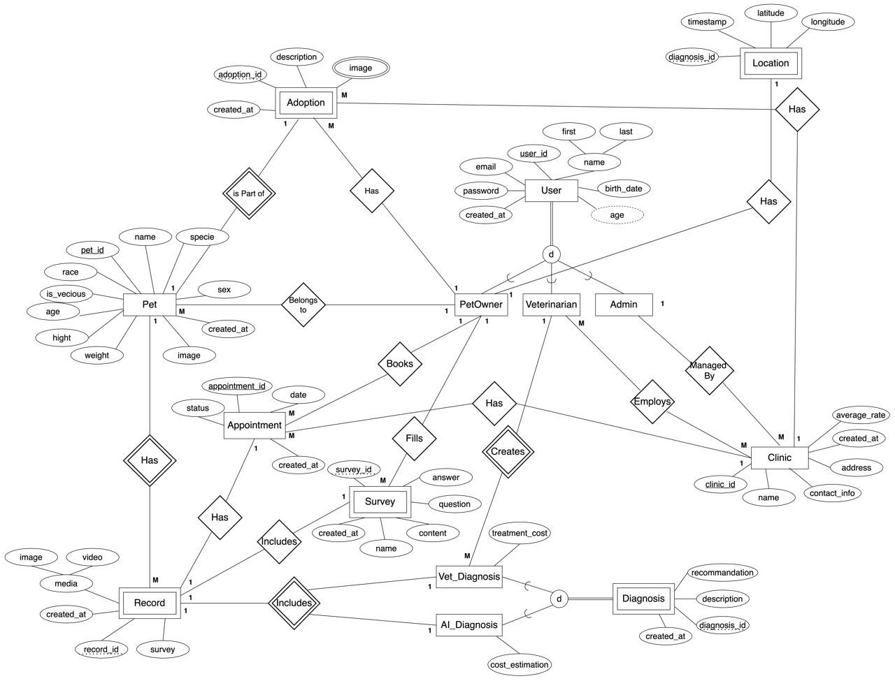
<br><sub>Entity relationship diagram (SDD §6.1)</sub>
</div>

The core relationships, as implemented in `buddy.Core/Entities`:

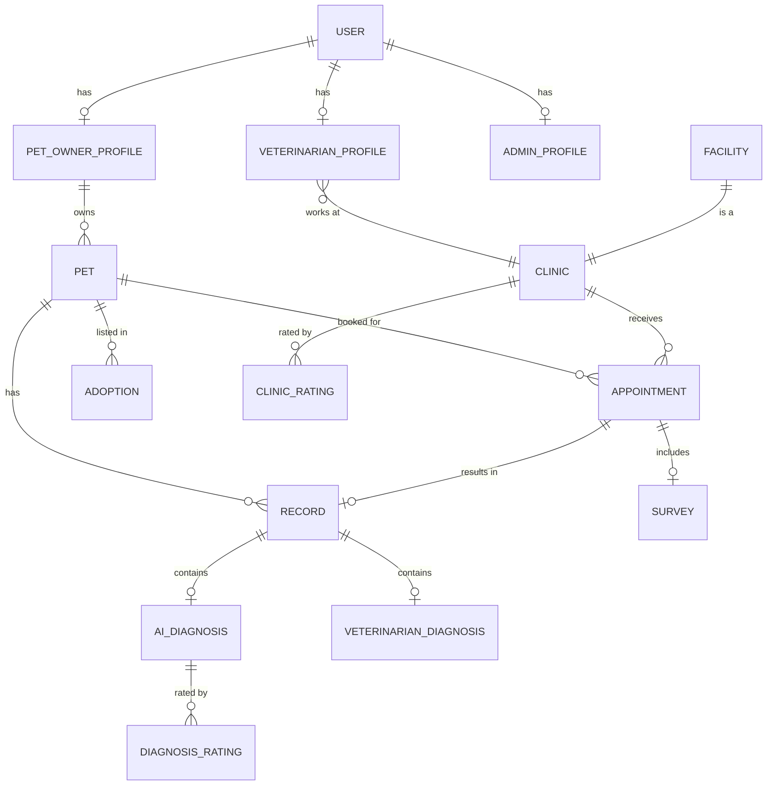

<details>
<summary>Class diagram (SDD §6.2)</summary>
<br>
<div align="center">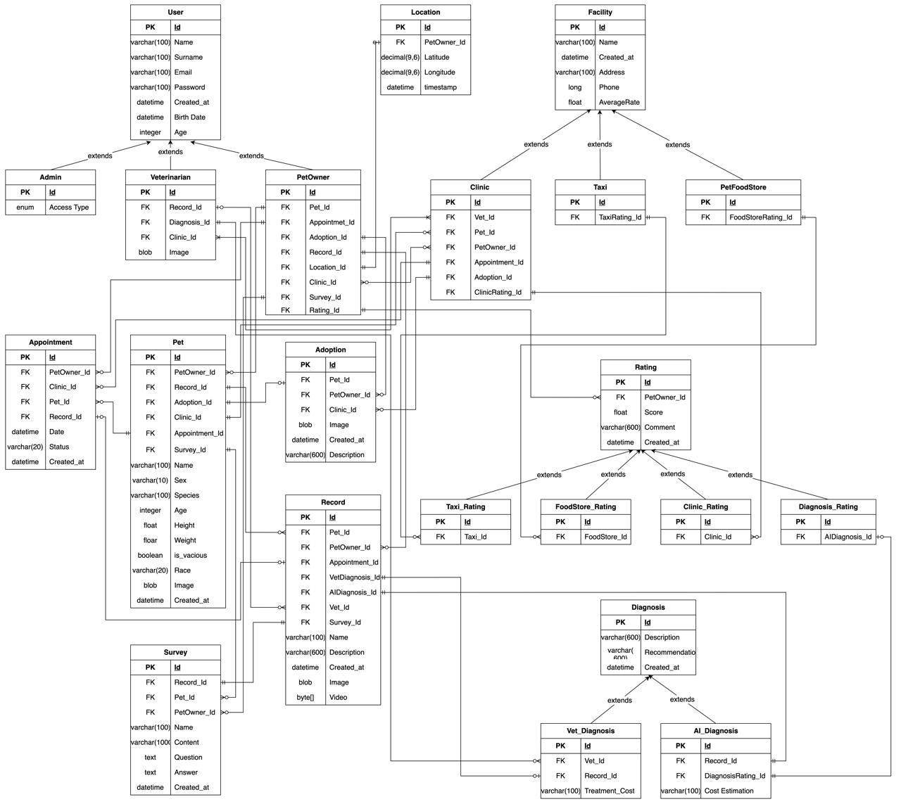</div>
</details>

## Interface design

The interfaces were designed as wireframes before implementation. The full sets are in [`Docs/05-Wireframes`](Docs/05-Wireframes), with activity diagrams per role in [`Docs/04-Diagrams`](Docs/04-Diagrams).

**Mobile (pet owner)**: start page, dashboard with navigation, records list, appointment editing, adoptions, symptom survey.

<div align="center">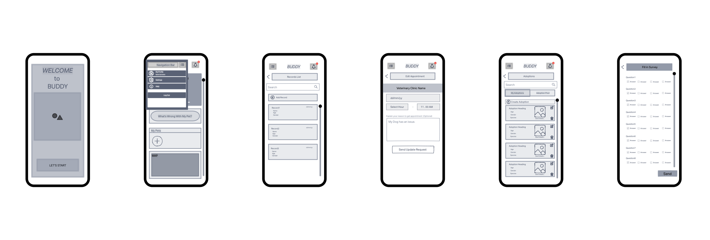</div>

**Web (veterinarian and admin)**: landing page, clinic home, appointments calendar, appointment requests, adoptions, admin dashboard.

<div align="center">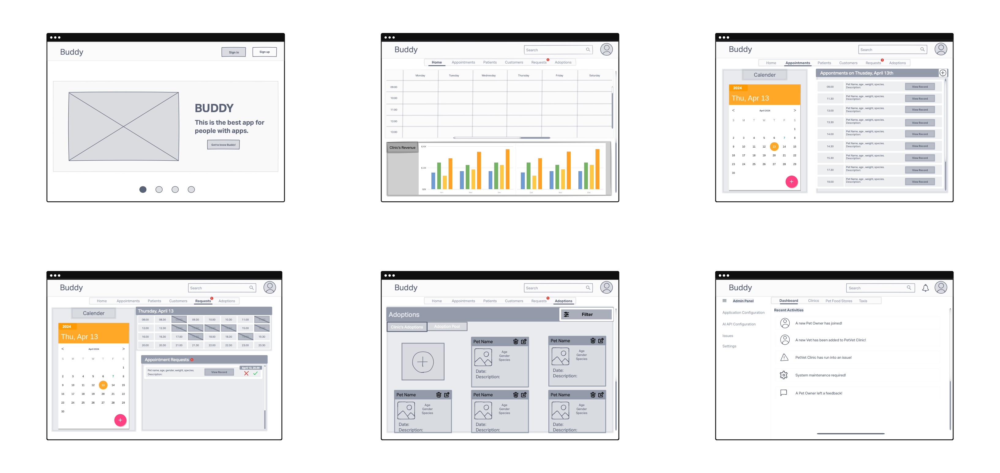</div>

## Repository layout

```
buddygraduationproject/
├── Web/                          ASP.NET Core solution (buddy.sln)
│   ├── src/
│   │   ├── buddy.Core/                   Domain: entities, roles, permissions
│   │   ├── buddy.Application/            App services, DTOs, AI integration
│   │   ├── buddy.EntityFrameworkCore/    DbContext, migrations, seed data
│   │   ├── buddy.Web.Core/               Shared web and auth configuration
│   │   ├── buddy.Web.Mvc/                MVC web application
│   │   ├── buddy.Web.Host/               REST API host with Swagger
│   │   └── buddy.Migrator/               Database migration runner
│   ├── test/                     xUnit test projects
│   ├── docker/                   Docker image and compose files
│   └── build/                    Build scripts
├── Mobile/                       Expo / React Native app (TypeScript)
└── Docs/
    ├── 01-Proposal-and-Research/ Project proposal, selection, market and literature research
    ├── 02-Requirements-SRS/      Software Requirements Specification (docx, pdf)
    ├── 03-Design-SDD/            Software Design Description
    ├── 04-Diagrams/              Activity, use case, class, ER, WBS (PNG and draw.io)
    ├── 05-Wireframes/            Mobile and web wireframes
    ├── 06-Testing/               Test cases per feature (F1–F7)
    └── Templates/                Document templates
```

## Getting started

### Prerequisites

- [.NET 8 SDK](https://dotnet.microsoft.com/download/dotnet/8.0)
- SQL Server (LocalDB, Express, or a container)
- Node.js 18+ for the mobile app
- A Google Gemini API key for the AI features

### Web application

```bash
cd Web

# 1. Point the connection string at your SQL Server
#    in src/buddy.Web.Mvc/appsettings.json and src/buddy.Migrator/appsettings.json

# 2. Create and seed the database
dotnet run --project src/buddy.Migrator

# 3. Provide the AI key (read from the environment, never committed)
export GEMINI_API_KEY="your-key"          # PowerShell: $env:GEMINI_API_KEY="your-key"

# 4. Run the web app
dotnet run --project src/buddy.Web.Mvc
```

The migrator seeds a default `admin` account using the standard ASP.NET Boilerplate development password. Change it, and replace the JWT `SecurityKey` values in `appsettings.json`, before deploying anywhere.

Front-end libraries are restored with LibMan from `libman.json` (Visual Studio does this on build; from the CLI run `libman restore` in `src/buddy.Web.Mvc`).

### Mobile application

```bash
cd Mobile
npm install
npx expo start
```

## Testing

Test cases are written per feature, one document per case, with a summary document for each feature. There are **65 test cases** in [`Docs/06-Testing`](Docs/06-Testing).

| Feature | Test cases | IDs |
|---------|:----------:|-----|
| F1 User Authentication & Authorization | 14 | `TC-AUTH-01` … `TC-AUTH-14` |
| F2 AI-Based Diagnosis System | 7 | `TC-AI-01` … `TC-AI-07` |
| F3 Appointment Scheduling & Management | 6 | `TC-AP-01` … `TC-AP-06` |
| F4 Pet & Profile Management | 13 | `TC-PP-01` … `TC-PP-13` |
| F5 Notification System | 8 | `TC-NOT-01` … `TC-NOT-08` |
| F6 Map-Based Service Access | 7 | `TC-MAP-01` … `TC-MAP-07` |
| F7 Admin Panel Operations | 10 | `TC-ADM-01` … `TC-ADM-10` |

Automated tests live in `Web/test` and run with `dotnet test` from the `Web` folder.

### Quality targets from the SRS

| Attribute | Target |
|-----------|--------|
| Concurrency | 200 simultaneous users without delay |
| AI pre-diagnosis | Response within 20 seconds, excluding uploads |
| Mobile start-up | Under 5 seconds on 90% of Android 10+ devices |
| Availability | 24/7, maintenance windows of at most one hour |
| Privacy | KVKK and GDPR compliance, explicit consent, encryption in transit and at rest |
| Languages | Turkish and English |

## Project documents

| Document | Description |
|----------|-------------|
| [Project Proposal](Docs/01-Proposal-and-Research/01-projectProposal.pdf) | Initial idea, motivation, and scope |
| [Project Selection](Docs/01-Proposal-and-Research/02-projectSelection.pdf) | Selection form |
| [Market & Literature Research](Docs/01-Proposal-and-Research/04-market-LiteratureResearch.pdf) | Comparable products and related work |
| [SRS](Docs/02-Requirements-SRS/SRS.pdf) ([docx](Docs/02-Requirements-SRS/SRS.docx)) | Requirements: interfaces, every function per role, use cases, quality attributes |
| [SDD](Docs/03-Design-SDD/SDD.docx) | Design: architecture, UI, high- and low-level design, database design, WBS |
| [Diagrams](Docs/04-Diagrams) | Activity diagrams per role, use case, class, ER, and WBS sources |
| [Wireframes](Docs/05-Wireframes) | Mobile and web screens |
| [Test cases](Docs/06-Testing) | 65 test cases across seven features |

<details>
<summary>Work breakdown structure (SDD §7)</summary>
<br>
<div align="center">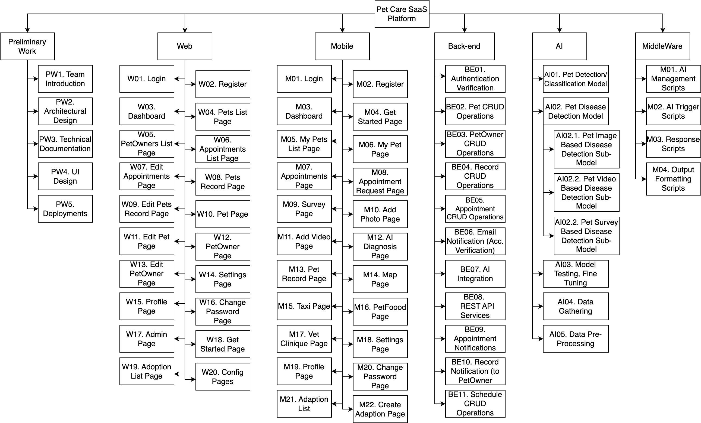</div>
</details>

## Implementation status

This repository holds the graduation project as it stood at the end of development, including work in progress.

| Area | Status |
|------|--------|
| Authentication, roles, user and tenant management | Implemented |
| Pet management | Implemented |
| AI analysis (text and image) with saved results | Implemented |
| Adoption pool and listings | Implemented |
| Appointments, records, clinics, veterinarian profiles | Services and pet-owner views implemented; veterinarian pages are static layouts not yet wired to data |
| Clinic map | Implemented for clinics; food stores and taxis are specified only |
| Notifications | Specified and test-planned; not fully implemented |
| Mobile app | Expo project scaffold; the screens in the wireframes are not yet built |

## Team

| Name | Student ID |
|------|-----------|
| Tanayça Ünlütürk | 202128203 |
| Çağan Sezim | 202128020 |
| Eda Kocaman | 202028003 |
| Dila Tümür | 202028024 |

Çankaya University, Software Engineering Department, SENG 491–492 Graduation Project, 2024–2025.

## License

Released under the [MIT License](LICENSE).
